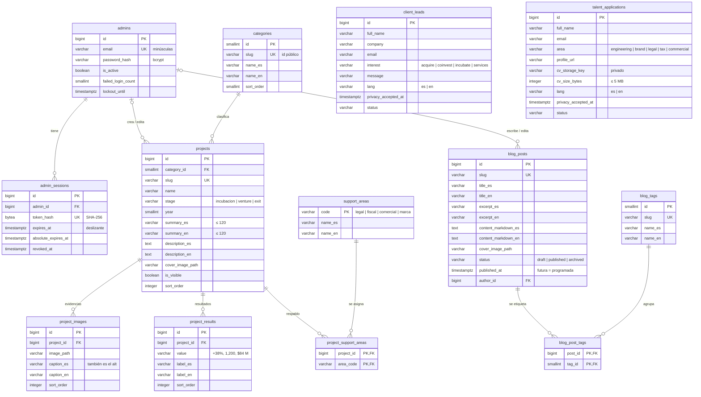

# Base de datos — Grupo Ricartti

Este documento describe el esquema relacional del proyecto (PostgreSQL 16 o superior). La fuente de verdad es [`database/sql/01_schema.sql`](../database/sql/01_schema.sql).

El modelo sigue el contrato del **handoff de frontend** (§9):

- **Contenido bilingüe ES/EN.**
- **Etapas** de proyecto, **año** y **áreas de respaldo**.
- **Evidencias en imagen** y **resultados** por separado.

Para entender cómo encaja la base de datos en el resto del sistema, consulta [ARCHITECTURE.md](ARCHITECTURE.md).

## 1. Diagrama entidad-relación



Las dos tablas de formularios son independientes: no tienen relaciones con otras tablas. Las columnas de auditoría (`created_by`, `updated_by`, `created_at`, `updated_at`) se omiten del diagrama.

## 2. Tablas

| Tabla | Propósito |
|---|---|
| `admins` | Cuentas del panel. Se crean desde el script de datos y todas tienen los mismos permisos. |
| `admin_sessions` | Sesiones de servidor. Se guarda el **hash** del token de la cookie, nunca el token. |
| `categories` | Filtro de la galería. El `slug` es el `Category.id` del contrato (`?categoria=fintech`). |
| `support_areas` | Catálogo de áreas de respaldo del grupo. La PK es el código estable del contrato. |
| `projects` | Tarjetas de la galería y su detalle, con textos ES/EN. Se ocultan, no se borran. |
| `project_support_areas` | Relación N:M entre proyectos y áreas de respaldo (`support[]` en el contrato). |
| `project_images` | Evidencias en imagen, con pie de foto ES/EN que también se usa como texto alternativo. |
| `project_results` | Cifras del detalle. `value` es texto de presentación, no un número. |
| `blog_posts` | Entradas del blog en Markdown, ES/EN. Pueden estar en borrador, publicadas (o programadas, si la fecha es futura) o archivadas. |
| `blog_tags` | Etiquetas del blog, con nombre ES/EN. |
| `blog_post_tags` | Relación N:M entre entradas y etiquetas. |
| `client_leads` | Formulario "Soy cliente o inversionista". |
| `talent_applications` | Formulario "Quiero trabajar en Grupo Ricartti", con CV en PDF opcional guardado de forma **privada**. |

## 3. Relaciones y reglas de borrado

| Relación | Regla | Motivo |
|---|---|---|
| `admin_sessions.admin_id → admins` | `ON DELETE CASCADE` | Las sesiones no existen sin su administrador. |
| `projects.category_id → categories` | `ON DELETE RESTRICT` | Una categoría con proyectos no se puede borrar; se desactiva. |
| `projects.created_by / updated_by → admins` | `ON DELETE SET NULL` | Si se elimina un administrador, sus proyectos se conservan. |
| `project_images / project_results / project_support_areas.project_id → projects` | `ON DELETE CASCADE` | Pertenecen al proyecto. |
| `project_support_areas.area_code → support_areas` | `ON DELETE RESTRICT` | Un área en uso no se puede borrar. |
| `blog_posts.author_id / created_by / updated_by → admins` | `ON DELETE SET NULL` | La entrada se conserva y el sitio muestra "Grupo Ricartti" como autor. |
| `blog_post_tags.post_id → blog_posts` | `ON DELETE CASCADE` | Las asignaciones desaparecen con la entrada. |
| `blog_post_tags.tag_id → blog_tags` | `ON DELETE RESTRICT` | Una etiqueta en uso no se puede borrar. |

## 4. Restricciones de negocio en la base de datos

La API valida todo antes de escribir. Aun así, la base de datos aplica las reglas críticas como última barrera:

- **Publicación:**
  - Un proyecto visible debe tener portada y el resumen y la descripción **en los dos idiomas** (`ck_projects_visible_requires_content`, handoff §6.17).
  - Una entrada `published` debe tener fecha, portada y la versión en inglés completa (`ck_blog_posts_published_requires_content`).
  - Los borradores pueden no tener la versión en inglés.
- **Rutas de archivo:** solo `/uploads/…` con extensión `jpg`, `jpeg`, `png` o `webp`. No se admiten `..`, espacios ni SVG.
- **CV:** la clave de almacenamiento debe ser `cv/<32 hex>.pdf`, generada por el servidor y nunca a partir del nombre del usuario. Los tres datos del CV van juntos y el tamaño máximo es 5 MB (`ck_talent_applications_cv_*`).
- **Formato de los datos:**
  - Correos normalizados en minúsculas.
  - Slugs con el formato `^[a-z0-9]+(-[a-z0-9]+)*$`.
  - Teléfonos con el formato `+52 618 123 4567`.
  - `profile_url` debe ser `http(s)`.
  - El resumen del proyecto tiene como máximo 120 caracteres.
  - El año va de 1990 a 2100.
- **Seguridad:** `password_hash` debe ser un hash bcrypt, `token_hash` debe medir 32 bytes y la expiración deslizante nunca supera la absoluta.
- **Formularios:** el aviso de privacidad es obligatorio (`privacy_accepted_at NOT NULL`) y `company` es obligatorio en el formulario de clientes.
- **Valores cerrados** (`CHECK … IN`), los mismos valores estables que envía el frontend:
  - `stage`: `incubacion`, `venture`, `exit`.
  - `interest`: `acquire`, `coinvest`, `incubate`, `services`.
  - `area`: `engineering`, `brand`, `legal`, `tax`, `commercial`.
  - `lang`: `es`, `en`.
  - `blog_posts.status`: `draft`, `published`, `archived`.
  - Estados de los formularios: `new`, `reviewed`, `contacted`, `shortlisted`, `archived`, según la tabla.

## 5. Índices

| Índice | Uso |
|---|---|
| `ix_projects_public_listing` (parcial, `WHERE is_visible`) | Galería pública ordenada por `sort_order` y `year DESC`. |
| `ix_projects_category_id` | Filtro por categoría. |
| `ix_project_images_project_order` / `ix_project_results_project_order` | Evidencias y resultados de un proyecto, ya ordenados. |
| `ix_project_support_areas_area` | Proyectos por área. La PK cubre el sentido inverso. |
| `ix_blog_posts_public_listing` (parcial, `WHERE status = 'published'`) | Blog público ordenado por `published_at DESC`. |
| `ix_blog_posts_status_updated` | Listado del panel filtrado por estado. |
| `ix_blog_post_tags_tag_id` | Filtro del blog por etiqueta. |
| `ix_admin_sessions_admin_id` / `…_absolute_expires_at` | Revocar las sesiones de un administrador y limpiar las expiradas. |
| `ix_client_leads_status_created` / `ix_talent_applications_status_created` | Bandejas del panel filtradas por estado. |
| `uq_*_ci` sobre `lower(name_es)` y `lower(name_en)` | Nombres de categoría y etiqueta únicos sin distinguir mayúsculas. |

## 6. Otros elementos

- **Trigger `set_updated_at()`:** mantiene `updated_at`. El contrato lo expone como `updatedAt`.
- **Extensión `unaccent`:** la búsqueda ignora acentos.
- **Concurrencia:** EF Core usa la columna de sistema `xmin` como token de versión.

## 7. Scripts

| Archivo | Ejecuta como | Qué hace |
|---|---|---|
| `database/sql/00_create_role_and_db.sql` | superusuario, en la base `postgres` | Crea el rol `ricartti_app` (sin privilegios de superusuario) y la base `ricartti`, que queda como su propiedad. Es idempotente y no contiene secretos. |
| `database/sql/01_schema.sql` | `SET ROLE ricartti_app`, en `ricartti` | Crea extensión, función, 13 tablas, restricciones, índices, triggers y comentarios, todo en una sola transacción. |
| `database/sql/02_seed.sql` | `SET ROLE ricartti_app`, en `ricartti` | Datos de prueba (ver §8). |
| `database/dump/ricartti_dump.sql` | `SET ROLE ricartti_app`, en `ricartti` | Volcado de `pg_dump` 17 con esquema y datos. Es una alternativa a 01 + 02 con resultado idéntico. |
| `database/docker/initdb.sh` | lo ejecuta el contenedor | Corre 00, 01 y 02 la primera vez que arranca el volumen. |
| `database/docker/load-dump.sh` | `docker compose exec db sh /docker-scripts/load-dump.sh` | Recrea la base dentro del contenedor a partir del volcado. |
| `scripts/db-setup.ps1` / `db-setup.sh` | tú, en local | Corre 00, 01 y 02 (o el volcado) leyendo la configuración de `.env`. |

## 8. Datos de prueba

**Todos los datos son ficticios.** El portafolio es el del handoff (§11, `src/api/mocks/seed.json`), con las imágenes del asset pack copiadas en `uploads/seed/<slug>/`.

| Tabla | Filas | Detalle |
|---|---|---|
| `admins` | 3 | 2 activos y 1 desactivado (credenciales en el README) |
| `categories` | 3 | Fintech, Agrotech, Salud digital |
| `support_areas` | 4 | Laboratorio de marca, Legal, Comercial, Fiscal |
| `projects` | 7 | 6 visibles y **Ruta Fría oculto** |
| `project_images` | 21 | 3 por proyecto |
| `project_results` | 18 | 3 por proyecto; Ruta Fría no tiene |
| `project_support_areas` | 17 | |
| `blog_tags` / `blog_posts` / `blog_post_tags` | 6 / 6 / 10 | 3 publicadas, 1 programada, 1 borrador sin inglés, 1 archivada |
| `client_leads` / `talent_applications` | 3 / 2 | Incluye un lead en inglés |

### Casos que permiten verificar el comportamiento

| Caso | Dato | Resultado esperado |
|---|---|---|
| Galería pública | 6 proyectos visibles, 2 por categoría | El filtro muestra Todos (6) + Fintech (2), Agrotech (2), Salud digital (2) |
| Proyecto oculto | `ruta-fria` | No aparece; `/proyectos/ruta-fria` y `GET /api/projects/ruta-fria` responden 404 |
| Orden de la galería | `sort_order` | kuali-pagos, nodo-credito, raiz-analytics, cosecha-directa, clinica-lince, dosis |
| Enlace directo | `/proyectos/kuali-pagos` | Abre el detalle con 3 resultados, 3 evidencias y 3 áreas de respaldo |
| Etapas | `dosis` = `exit` | La tarjeta muestra la etapa "Vendido" con su marcador ◆ |
| Búsqueda sin acentos | `credito` | Encuentra "Nodo Crédito" |
| Cuenta desactivada | `inactivo@gruporicartti.test` | El login falla con el mensaje genérico |
| Blog público | 3 entradas publicadas | Listado de la más reciente a la más antigua, en ES y EN |
| Entrada programada | `agrotech-en-el-norte-de-mexico` (2030) | No aparece en el sitio; en el panel figura como "Programada" |
| Borrador sin inglés | `guia-para-presentar-tu-proyecto` | No se puede publicar hasta completar el inglés (la BD lo rechaza) |
| Filtro por etiqueta | `tag=inversion` | 2 entradas |

## 9. Generar el volcado

El volcado se regenera cada vez que cambian el esquema o los datos de prueba. Ejecuta los comandos desde `GR-backend`:

```bash
# Con Docker (lo escribe en database/dump/ desde dentro del contenedor)
docker compose exec db pg_dump -U postgres -d ricartti --no-owner --no-privileges -f /dump/ricartti_dump.sql

# Con PostgreSQL local
pg_dump -h localhost -U postgres -d ricartti --no-owner --no-privileges -f database/dump/ricartti_dump.sql
```

> **En Windows:**
> - **PowerShell:** **no** redirijas la salida con `>`, porque escribe el archivo en UTF-16. Usa siempre `-f`.
> - **Git Bash:** antepón `MSYS_NO_PATHCONV=1` al comando de Docker. Si no lo haces, Git Bash convierte `/dump/...` en una ruta de Windows.
>
> **Versión de `psql` para cargar el volcado:** `pg_dump` 17.6 o superior escribe al inicio la meta-orden `\restrict` (una medida de seguridad de PostgreSQL). Para cargar el volcado se necesita `psql` 17.6 o superior, o la última versión menor de la rama 13–16. Las instalaciones actuales de PostgreSQL 17 ya la incluyen.
