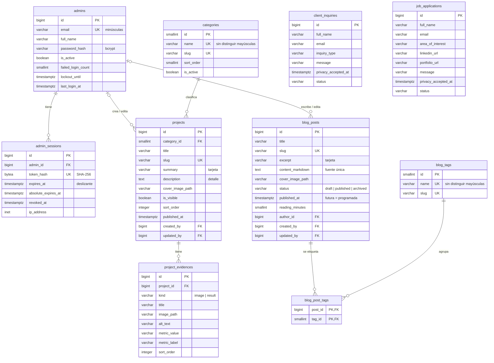

# Base de datos — Grupo Ricartti

Este documento describe el esquema relacional del proyecto (PostgreSQL 16 o superior). La fuente de verdad es [`database/sql/01_schema.sql`](../database/sql/01_schema.sql). Para entender cómo encaja la base de datos en el resto del sistema, consulta [ARCHITECTURE.md](ARCHITECTURE.md).

## 1. Diagrama entidad-relación



Las dos tablas de formularios son independientes: no tienen relaciones con otras tablas.

## 2. Tablas

| Tabla | Propósito |
|---|---|
| `admins` | Cuentas del panel. Se crean desde el script de datos y todas tienen los mismos permisos. |
| `admin_sessions` | Sesiones de servidor. Se guarda el **hash** del token de la cookie, nunca el token. |
| `categories` | Filtro de la galería. Las categorías inactivas no se muestran al público. |
| `projects` | Tarjetas de la galería y su detalle. Los proyectos se ocultan, no se borran. |
| `project_evidences` | Evidencias del detalle de un proyecto: imagen **o** resultado (métrica). |
| `blog_posts` | Entradas del blog en Markdown. Pueden estar en borrador, publicadas (o programadas, si `published_at` es futura) o archivadas. No se borran. |
| `blog_tags` | Etiquetas del blog. Se crean desde el editor de entradas. |
| `blog_post_tags` | Relación N:M entre entradas y etiquetas. |
| `client_inquiries` | Formulario de clientes interesados. |
| `job_applications` | Formulario "Trabaja con nosotros". |

## 3. Relaciones y reglas de borrado

| Relación | Regla | Motivo |
|---|---|---|
| `admin_sessions.admin_id → admins` | `ON DELETE CASCADE` | Las sesiones no existen sin su administrador. |
| `projects.category_id → categories` | `ON DELETE RESTRICT` | Una categoría que tiene proyectos no se puede borrar; se desactiva. |
| `projects.created_by / updated_by → admins` | `ON DELETE SET NULL` | Si se elimina un administrador, sus proyectos se conservan. |
| `project_evidences.project_id → projects` | `ON DELETE CASCADE` | Las evidencias pertenecen al proyecto. |
| `blog_posts.author_id / created_by / updated_by → admins` | `ON DELETE SET NULL` | La entrada se conserva y el sitio muestra "Grupo Ricartti" como autor. |
| `blog_post_tags.post_id → blog_posts` | `ON DELETE CASCADE` | Las asignaciones de etiquetas desaparecen con la entrada. |
| `blog_post_tags.tag_id → blog_tags` | `ON DELETE RESTRICT` | Una etiqueta en uso no se puede borrar. |

## 4. Restricciones de negocio en la base de datos

La API valida todo antes de escribir. Aun así, la base de datos aplica las reglas críticas como última barrera:

- **Publicación:**
  - Un proyecto visible debe tener portada (`ck_projects_visible_requires_cover`) y fecha de publicación (`ck_projects_visible_requires_published_at`).
  - Una entrada `published` debe tener `published_at` (`ck_blog_posts_published_requires_date`) y portada (`ck_blog_posts_published_requires_cover`).
- **Contenido del blog:** el Markdown tiene entre 1 y 50 000 caracteres y el tiempo de lectura va de 1 a 600 minutos.
- **Forma de las evidencias** (`ck_project_evidences_shape`):
  - `image` exige `image_path` y `alt_text` y no admite campos de métrica.
  - `result` exige `metric_value` y `metric_label` y no admite imagen.
- **Rutas de archivo:** solo `/uploads/…` con extensión `jpg`, `jpeg`, `png` o `webp`. No se admiten `..`, espacios ni SVG.
- **Formato de los datos:**
  - Correos normalizados en minúsculas.
  - Slugs con el formato `^[a-z0-9]+(-[a-z0-9]+)*$`.
  - Teléfonos con el formato `+52 55 1234 5678`.
  - LinkedIn solo en `https://…linkedin.com/…`.
  - El portafolio debe ser `https`.
- **Seguridad:**
  - `password_hash` debe ser un hash bcrypt (60 caracteres, prefijo `$2a$`, `$2b$` o `$2y$`).
  - `token_hash` debe medir exactamente 32 bytes.
  - La expiración deslizante nunca supera la absoluta.
- **Formularios:** el aviso de privacidad es obligatorio (`privacy_accepted_at NOT NULL`). La postulación exige al menos LinkedIn o portafolio.
- **Valores cerrados (`CHECK … IN`):**
  - `kind`: `image`, `result`.
  - `blog_posts.status`: `draft`, `published`, `archived`.
  - `inquiry_type`: `funding`, `partnership`, `co_investment`, `other`.
  - `area_of_interest`: `investment_analysis`, `finance`, `legal`, `technology`, `marketing`, `operations`, `other`.
  - Estados: `new`, `reviewed`, `contacted`, `shortlisted`, `archived`, según la tabla.

## 5. Índices

| Índice | Uso |
|---|---|
| `ix_projects_public_listing` (parcial, `WHERE is_visible`) | Galería pública ordenada por `sort_order` y `published_at`. |
| `ix_projects_category_id` | Filtro por categoría. |
| `ix_project_evidences_project_order` | Evidencias de un proyecto, ya ordenadas. |
| `ix_blog_posts_public_listing` (parcial, `WHERE status = 'published'`) | Blog público ordenado por `published_at DESC`. |
| `ix_blog_posts_status_updated` | Listado del panel filtrado por estado. |
| `ix_blog_posts_author_id` | Entradas de un autor y borrado `SET NULL` sin recorrer toda la tabla. |
| `ix_blog_post_tags_tag_id` | Filtro del blog por etiqueta. La PK `(post_id, tag_id)` cubre el sentido inverso. |
| `uq_blog_tags_name_ci` (`lower(name)`) | Nombres de etiqueta únicos sin distinguir mayúsculas. |
| `ix_admin_sessions_admin_id` / `…_absolute_expires_at` | Revocar todas las sesiones de un administrador y limpiar las expiradas. |
| `ix_client_inquiries_status_created` / `ix_job_applications_status_created` | Bandejas del panel filtradas por estado. |
| `uq_categories_name_ci` (`lower(name)`) | Nombres de categoría únicos sin distinguir mayúsculas. |

## 6. Otros elementos

- **Trigger `set_updated_at()`:** mantiene `updated_at` en todas las tablas editables.
- **Extensión `unaccent`:** la búsqueda de la galería ignora acentos.
- **Concurrencia:** EF Core usa la columna de sistema `xmin` como token de versión, así que no hace falta una columna adicional.

## 7. Scripts

| Archivo | Ejecuta como | Qué hace |
|---|---|---|
| `database/sql/00_create_role_and_db.sql` | superusuario, en la base `postgres` | Crea el rol `ricartti_app` (sin privilegios de superusuario) y la base `ricartti`, que queda como su propiedad. Es idempotente y no contiene secretos: recibe los valores como variables de `psql`. |
| `database/sql/01_schema.sql` | `SET ROLE ricartti_app`, en `ricartti` | Crea extensión, función, tablas, restricciones, índices, triggers y comentarios, todo en una sola transacción. |
| `database/sql/02_seed.sql` | `SET ROLE ricartti_app`, en `ricartti` | Carga los datos de prueba ficticios: 3 administradores, 7 categorías, 11 proyectos, 25 evidencias, 6 etiquetas, 6 entradas de blog (11 asignaciones de etiqueta) y 5 formularios. |
| `database/dump/ricartti_dump.sql` | `SET ROLE ricartti_app`, en `ricartti` | Volcado de `pg_dump` con esquema y datos. Es una alternativa a 01 + 02. |
| `database/docker/initdb.sh` | lo ejecuta el contenedor | Corre 00, 01 y 02 la primera vez que arranca el volumen. |
| `database/docker/load-dump.sh` | `docker compose exec db sh /docker-scripts/load-dump.sh` | Recrea la base dentro del contenedor a partir del volcado. |
| `scripts/db-setup.ps1` / `db-setup.sh` | tú, en local | Corre 00, 01 y 02 (o el volcado) leyendo la configuración de `.env`. |

### Datos de prueba para verificar el comportamiento

| Caso | Dato | Resultado esperado |
|---|---|---|
| Paginación | 9 proyectos visibles con `pageSize=6` | 2 páginas |
| Proyecto oculto | `hidro-pura` (borrador) y `mercado-verde` (pausado) | No aparecen en la galería; `GET /api/projects/hidro-pura` responde 404 |
| Categoría inactiva | `educacion` | No aparece en `/api/categories` |
| Categoría con proyectos ocultos | `agrotecnologia` | Solo muestra `sensa-campo` |
| Búsqueda sin acentos | `q=credito` | Encuentra "Crédito Semilla" |
| Cuenta desactivada | `inactivo@gruporicartti.test` | El login falla con el mensaje genérico |
| Blog público | 3 entradas `published` con fecha pasada | El listado muestra 3, de la más reciente a la más antigua |
| Entrada programada | `tendencias-fintech-proxima-decada` (fecha en 2030) | No aparece en el sitio; en el panel figura como "Programada" |
| Borrador y archivada | `guia-primera-ronda-de-inversion` y `resultados-portafolio-2024` | Solo se ven en el panel; su URL pública responde 404 |
| Filtro por etiqueta | `tag=inversion` | 2 entradas |
| Búsqueda en el blog sin acentos | `q=energia` | Encuentra "Energía limpia: por qué apostamos…" |
| Autores distintos | Entradas de `admin@` y de `operaciones@` | Cada entrada muestra su autor |

## 8. Generar el volcado

El volcado se regenera cada vez que cambian el esquema o los datos de prueba:

```bash
# Con Docker (lo escribe en database/dump/ desde dentro del contenedor)
docker compose exec db pg_dump -U postgres -d ricartti --no-owner --no-privileges -f /dump/ricartti_dump.sql

# Con PostgreSQL local
pg_dump -h localhost -U postgres -d ricartti --no-owner --no-privileges -f database/dump/ricartti_dump.sql
```

> **En Windows:**
> - **PowerShell:** **no** redirijas la salida con `>`, porque escribe el archivo en UTF-16. Usa siempre `-f`.
> - **Git Bash:** antepón `MSYS_NO_PATHCONV=1` al comando de Docker. Si no lo haces, Git Bash convierte `/dump/...` en una ruta de Windows:
>
>   `MSYS_NO_PATHCONV=1 docker compose exec db pg_dump -U postgres -d ricartti --no-owner --no-privileges -f /dump/ricartti_dump.sql`
>
> Todos los comandos se ejecutan desde la carpeta `GR-backend`.
